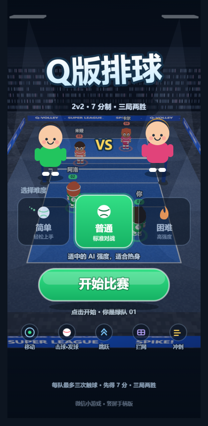
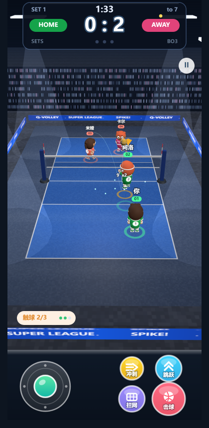
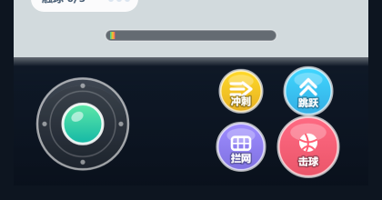
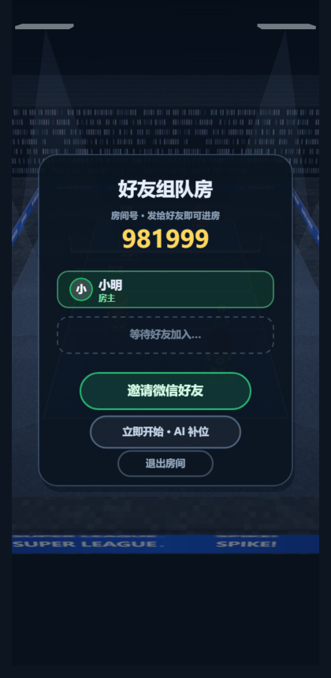

# 弹弹排球 · 微信小游戏

**中文** | [English](#english)

## 项目简介

从桌面版 three.js 排球游戏移植的微信小游戏版本，竖屏布局：上方 5/6 是 3D 球场，底部 1/6 是虚拟手柄。玩法为 2v2：

- **单人模式**：1 名玩家 + 1 名 AI 队友，对战 2 名 AI；
- **好友组队**：微信好友 2 人同队，对战 2 名 AI，基于微信云开发（云函数 + 云数据库）同步，不自建服务器。

## 预览

| 首页 | 比赛中 |
| --- | --- |
|  |  |

| 底部手柄 | 联机等待房间 |
| --- | --- |
|  |  |

## 当前进度

- **人物重做**：低多边形卡通造型，4 种发型 / 6 种发色 / 4 种肤色，号码白底圆牌，我方草绿、对手珊瑚红。根因是旧版角色套了放大的深色反向描边壳，移动端深度缓冲精度不足会糊成纯黑，已移除。
- **手柄重做**：糖果质感按键（渐变 + 白描边 + 烘焙投影 + 顶部高光）、图标与文字双通道、按压态、摇杆刻度与渐变旋钮、圆角渐变蓄力条。
- **场馆与记分牌重做**：东京蓝比赛区 + 灰蓝无障碍区 + 白线，整片地板烘焙成一张贴图单 mesh；新增看台、环形 LED 板、顶部灯板与光束；记分牌改为电子屏风格（发光比分、mm:ss、局分点、发球方指示）。
- **微信运行时兼容**：`wx.createOffscreenCanvas` 不可用时回退到 `wx.createCanvas`；为 wx canvas 补齐 DOM 接口；材质改为不吃光照 + 固定色彩管线；新增 `?rawcanvas=1`、`?safefx=1` 自检开关与安全渲染模式。
- **首页重做**：球场当舞台 + 立绘 + VS、logo 化标题、草绿主 CTA、难度三卡片、图标化操作提示、页面垂直居中。
- **好友组队联机**：房主权威仿真 + 8Hz 快照直写 + 客机 watch 插值；输入 10Hz 上送；好友断线由 AI 接管，客机自动重连。

## 功能

- 一传 → 二传 → 扣杀、网前拦网、冲刺扑救、蓄力发球，7 分制三局两胜。
- 竖屏布局：3D 视口限制在上方 5/6，底部固定手柄区。
- 虚拟手柄：左半区浮动摇杆，右侧跳跃 / 击球 / 拦网 / 冲刺四个按键，支持多点触控。
- 蓄力发球：按住击球键蓄力，拨动摇杆左右瞄准，松手发出。
- 难度选择：简单 / 普通 / 困难，影响 AI 移动速度、反应和扣球能力。
- HUD 全部用 canvas 绘制：计时、比分、局数、触球计数、蓄力条、播报、暂停与结算面板。
- 程序化音效，不依赖任何音频素材。
- 好友组队：创建 6 位房间号、分享卡片进房、满员或 AI 补位开局、断线 AI 接管与重连。
- 小游戏适配层：上屏 canvas、离屏 2D canvas、WebAudio、触屏事件、安全区、分享与冷启动参数。
- three.js 固定 0.162.0，保留 WebGL1 回退，兼容更多机型。

## 快速开始

环境要求：Node.js 18+、npm、微信开发者工具。

```bash
cd minigame
npm install
npm run build
```

**构建产物**：`minigame/js/main.js` 是小游戏运行包，随仓库提交；`minigame/web/bundle.js` 是浏览器调试包，已被 `.gitignore` 忽略，运行 `npm run dev` 时生成。

**浏览器调试**：

```bash
cd minigame
npm run dev
```

打开 <http://localhost:5173/web/>。

**类型检查**：

```bash
cd minigame
npm run typecheck
```

**真机预览**：在微信开发者工具中导入 `minigame` 目录，项目类型选择“小游戏”，`project.config.json` 已配置 appid 与云环境，编译后预览即可。

**云函数部署**：`minigame/cloudfunctions/` 下的 5 个函数需在微信开发者工具中逐个上传部署，并创建 4 个数据库集合与安全规则，完整步骤见 [docs/cloud-deploy.md](docs/cloud-deploy.md)。联机方案与协议说明见 [docs/online-mode.md](docs/online-mode.md)。

## 最低基础库

- **理论最低 1.9.94**（依赖 `wx.createCanvas` 的离屏行为）。
- **建议 ≥ 2.16.1**（原生支持 `wx.createOffscreenCanvas`，云开发与实时推送更稳定）。
- PC 微信（3.9.x）小游戏 runtime 没有 `createOffscreenCanvas`，代码已自动回退到 `wx.createCanvas`（见 `src/platform/wx-shim.ts` 的 `create2dCanvas`），无需额外配置。
- 云联机要求基础库 ≥ 2.16.1（`project.config.json` 已配置 `libVersion: 3.9.0`）。

## 联机模式（云开发）

- **控制流走云函数**：`createRoom` / `joinRoom` / `startMatch` / `settleMatch` / `markDisconnect`。
- **状态流走数据库**：房主 8Hz 直写 `rooms_live` 快照，客机 `watch` + 两帧插值；好友输入 10Hz 写入 `rooms_inputs`。
- **集合**：`rooms`（房间与席位）、`rooms_live`（对局快照）、`rooms_inputs`（输入上行）、`matches`（结算历史）。
- **断线兜底**：房主侧好友输入静默超过 6s → AI 接管；客机侧快照静默超过 8s → 自动重连 3 次。
- **本地测试**：`minigame/tools/room-server.mjs` 提供零依赖本地 WebSocket 房间服务器，`tools/e2e-online.mjs` 可跑双客户端整局自动化测试。
- **配置位置**：`minigame/src/config/cloud.ts` 的 `CLOUD_ENV`；留空即关闭云联机，回落单人模式。

## 目录结构

```text
minigame/
  src/
    sim/          # 纯 TypeScript 模拟层：World / Ball / AI / 规则
    render/       # three.js 表现层：球场、角色、球、粒子
    ui/           # canvas HUD、底部手柄、开始/结算/暂停/联机房间
    platform/     # 微信小游戏垫片、浏览器调试平台、诊断面板
    net/          # 联机传输、快照镜像、云开发 / 本地 WS 客户端
    config/       # 云环境与同步频率配置
    audio/        # 程序化 WebAudio 音效
  cloudfunctions/ # 5 个云函数（createRoom / joinRoom / startMatch / settleMatch / markDisconnect）
  tools/          # 本地房间服务器、E2E 与诊断脚本（仅开发用）
  js/main.js      # 小游戏运行包（构建产物，入库）
  web/            # 浏览器调试页面 + wx 运行时模拟
  game.js
  game.json
  project.config.json
legacy/           # 原始桌面版与线上版参考代码
docs/             # 视觉/兼容/联机/部署说明与验证截图
```

## 已知限制

- **房主断线不可恢复**：权威仿真在房主端，对局中房主断线客机只收到明确提示，无法接管；彻底解决需服务端权威仿真。
- **好友不发球**：现有仿真固定 0 号位发球，好友（1 号位）整局不会发球，联机两端体验略有不对称。
- **房间需定时清理**：等待房依赖双方主动退出删除，异常残留房需要配置云开发定时触发器清理（本期未加）。
- **真机主循环卡死修复进行中**：真机“点开始比赛后画面定格”的调度 watchdog、异常面板与安全渲染已写入，本地模拟矩阵验证通过；真机根因仍在确认中，暂不宣称已修复，详见 [docs/start-freeze-audit.md](docs/start-freeze-audit.md)。
- 新版隐私协议下 `wx.getUserInfo` 常只返回匿名昵称，头像以首字符占位，真实头像需开放数据域。

## License

MIT

---

<a id="english"></a>

# Dandan Volley — WeChat Mini Game

**中文** | [English](#english)

## Overview

A WeChat Mini Game port of the original three.js desktop volleyball game, laid out in portrait: the top 5/6 is the 3D court and the bottom 1/6 is a virtual gamepad. It supports two 2v2 modes:

- **Single player**: one player plus one AI teammate against two AI opponents.
- **Play with a friend**: two WeChat friends on the same team against two AI opponents, synced through WeChat CloudBase (cloud functions + cloud database) with no self-hosted server.

## Preview

| Home | Mid-match |
| --- | --- |
|  |  |

| Gamepad | Online waiting room |
| --- | --- |
|  |  |

## What's done

- **Characters rebuilt**: low-poly cartoon style with 4 hairstyles, 6 hair colors and 4 skin tones, white number badges and grass-green vs coral-red kits. The black-silhouette bug is gone: the old build wrapped characters in an oversized dark back-face shell, which collapsed into pure black under mobile depth-buffer precision limits.
- **Gamepad rebuilt**: candy-style buttons (gradient fill, white stroke, baked shadow, top highlight), icon plus label, pressed states, a notched joystick with a gradient knob, and a rounded gradient power bar.
- **Court and scoreboard rebuilt**: Tokyo-blue play area, gray-blue free zone and white lines, with the whole floor baked into a single-texture mesh; plus stands, a ring LED board, ceiling light panels and light beams. The scoreboard is now an electronic-display style board with glowing scores, mm:ss, set pips and a serving-side indicator.
- **WeChat runtime compatibility**: falls back from `wx.createOffscreenCanvas` to `wx.createCanvas`, fills in the DOM APIs the wx canvas lacks, drops runtime lighting in favor of unlit materials with a fixed color pipeline, and adds `?rawcanvas=1` / `?safefx=1` self-check flags plus a safe render mode.
- **Home screen rebuilt**: the court as a stage with character art and a VS mark, a logo-style title, a grass-green primary CTA, three difficulty cards, icon-only control hints, and vertically centered content.
- **Online co-op**: host-authoritative simulation with 8 Hz snapshot writes and guest-side `watch` interpolation, 10 Hz input uplink, AI takeover when a friend drops, and automatic reconnect.

## Features

- Pass → set → spike, net blocking, sprint saves, charged serves, first to 7 points, best of 3 sets.
- Portrait layout: the 3D viewport occupies the top 5/6, with a fixed gamepad area at the bottom.
- Virtual gamepad: a floating joystick on the left half and jump / hit / block / sprint buttons on the right, with multi-touch support.
- Charged serve: hold the hit button to charge, aim left or right with the joystick, release to serve.
- Difficulty selection: easy / normal / hard, affecting AI movement speed, reaction and spiking.
- Canvas-drawn HUD: timer, score, sets, touch count, power bar, announcements, pause and result panels.
- Procedural sound effects with no audio assets.
- Online co-op: 6-digit room codes, share-card join, auto start when the room fills or with an AI fill-in, AI takeover on disconnect and reconnect.
- Mini game adapter: on-screen canvas, off-screen 2D canvases, WebAudio, touch events, safe areas, sharing and launch query parsing.
- three.js pinned to 0.162.0 with a WebGL1 fallback for wider device compatibility.

## Quick start

Requirements: Node.js 18+, npm, WeChat DevTools.

```bash
cd minigame
npm install
npm run build
```

**Build output**: `minigame/js/main.js` is the Mini Game runtime bundle and is committed; `minigame/web/bundle.js` is the browser debugging bundle and is ignored by `.gitignore`, generated on demand by `npm run dev`.

**Browser debugging**:

```bash
cd minigame
npm run dev
```

Open <http://localhost:5173/web/>.

**Type checking**:

```bash
cd minigame
npm run typecheck
```

**On a device**: import the `minigame` folder into WeChat DevTools, choose “Mini Game” as the project type, and preview. `project.config.json` already carries the appid and cloud environment.

**Cloud functions**: the five functions under `minigame/cloudfunctions/` must each be uploaded from WeChat DevTools, along with four database collections and their security rules. See [docs/cloud-deploy.md](docs/cloud-deploy.md) for the full walkthrough and [docs/online-mode.md](docs/online-mode.md) for the design and protocol.

## Minimum base library

- **Theoretical minimum 1.9.94** (relies on the offscreen behavior of `wx.createCanvas`).
- **Recommended ≥ 2.16.1** (native `wx.createOffscreenCanvas`, plus more stable CloudBase realtime push).
- PC WeChat 3.9.x does not implement `createOffscreenCanvas` in its Mini Game runtime; the code falls back to `wx.createCanvas` automatically (see `create2dCanvas` in `src/platform/wx-shim.ts`), with no extra configuration.
- Online play requires base library ≥ 2.16.1 (`project.config.json` is set to `libVersion: 3.9.0`).

## Online mode (CloudBase)

- **Control flow through cloud functions**: `createRoom` / `joinRoom` / `startMatch` / `settleMatch` / `markDisconnect`.
- **State flow through the database**: the host writes snapshots to `rooms_live` at 8 Hz; the guest uses `watch` plus two-frame interpolation. Friend input is written to `rooms_inputs` at 10 Hz.
- **Collections**: `rooms` (rooms and seats), `rooms_live` (match snapshots), `rooms_inputs` (input uplink), `matches` (match history).
- **Disconnect handling**: on the host, 6 s of input silence from the friend triggers AI takeover; on the guest, 8 s of snapshot silence triggers up to three reconnect attempts.
- **Local testing**: `minigame/tools/room-server.mjs` is a zero-dependency local WebSocket room server, and `tools/e2e-online.mjs` runs a full match with two clients.
- **Configuration**: `CLOUD_ENV` in `minigame/src/config/cloud.ts`. Leave it empty to disable online play and stay in single-player mode.

## Project structure

```text
minigame/
  src/
    sim/          # Pure TypeScript simulation: World / Ball / AI / rules
    render/       # three.js presentation: court, characters, ball, particles
    ui/           # Canvas HUD, gamepad, start/result/pause/online room screens
    platform/     # WeChat Mini Game shim, browser debug platform, diagnostics panel
    net/          # Transport, snapshot mirror, CloudBase and local WS clients
    config/       # Cloud environment and sync frequency settings
    audio/        # Procedural WebAudio sound effects
  cloudfunctions/ # Five cloud functions (createRoom / joinRoom / startMatch / settleMatch / markDisconnect)
  tools/          # Local room server, E2E and diagnostic scripts (development only)
  js/main.js      # Mini Game runtime bundle (build output, committed)
  web/            # Browser debugging page + wx runtime simulation
  game.js
  game.json
  project.config.json
legacy/           # Reference copies of the original desktop and online versions
docs/             # Visual, compatibility, online and deploy notes plus verification screenshots
```

## Known limitations

- **Host disconnect is unrecoverable**: the authoritative simulation runs on the host. If the host drops mid-match, the guest only gets a clear notice and cannot take over; a true fix needs server-authoritative simulation.
- **The friend never serves**: the simulation always serves from slot 0, so the friend (slot 1) does not serve at all, making the two ends of an online match slightly asymmetric.
- **Rooms need scheduled cleanup**: waiting rooms are deleted when both sides leave. Rooms left behind by crashed processes need a scheduled CloudBase trigger, which is not configured yet.
- **Real-device freeze fix in progress**: the scheduling watchdog, error panel and safe render mode for the “screen freezes after tapping Start Match” bug are in place and pass the local simulated matrix. The real-device root cause is still being confirmed, so this is not yet claimed as fixed. See [docs/start-freeze-audit.md](docs/start-freeze-audit.md).
- Under the new privacy rules `wx.getUserInfo` often returns an anonymous nickname; avatars fall back to the first character of the name. Real avatars need the open-data context.

## License

MIT
