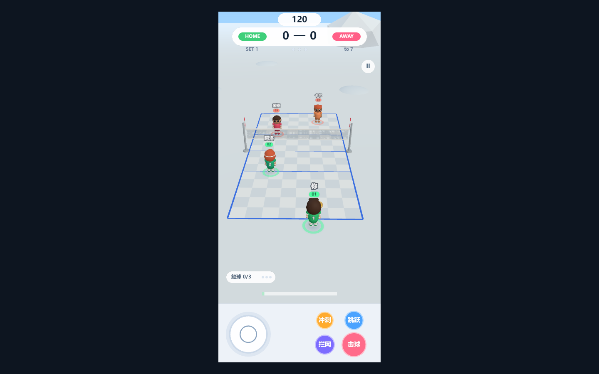
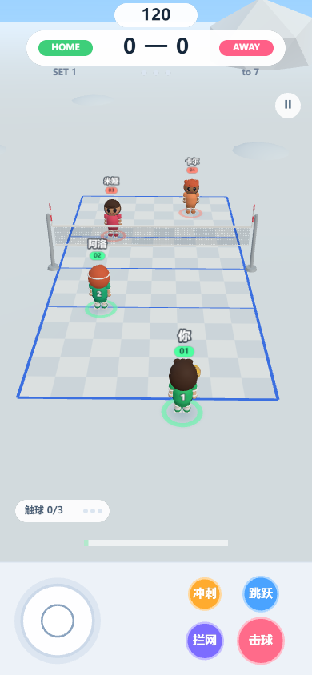

# Q版排球 · 微信小游戏

**中文** | [English](#english)

## 项目简介

从桌面版 three.js 排球游戏移植的微信小游戏版本。保留原来的 2v2 人机玩法：1 名玩家 + 1 名 AI 队友，对战 2 名 AI。画面改为竖屏，上方 5/6 是 3D 球场，底部 1/6 是虚拟手柄。

## 预览





## 功能

- 保留原玩法：一传 → 二传 → 扣杀、网前拦网、冲刺扑救、蓄力发球，7 分制三局两胜。
- 竖屏布局：3D 视口限制在上方 5/6，底部固定手柄区。
- 虚拟手柄：左半区浮动摇杆，右侧跳跃 / 击球 / 拦网 / 冲刺四个按键，支持多点触控。
- 蓄力发球：按住击球键蓄力，拨动摇杆左右瞄准，松手发出。
- 难度选择：简单 / 普通 / 困难，影响 AI 移动速度、反应和扣球能力。
- HUD 全部用 canvas 绘制：计时、比分、局数、触球计数、蓄力条、播报、暂停与结算面板。
- 程序化音效，不依赖任何音频素材。
- 小游戏适配层：上屏 canvas、离屏 2D canvas、WebAudio、触屏事件、安全区。
- three.js 固定 0.162.0，保留 WebGL1 回退，兼容更多机型。

## 快速开始

环境要求：Node.js 18+、npm、微信开发者工具。

```bash
cd minigame
npm install
npm run build
```

然后在微信开发者工具中导入 `minigame` 目录，项目类型选择“小游戏”。把 `minigame/project.config.json` 里的 `appid` 替换成你自己的小游戏 AppID 即可真机预览。

浏览器调试：

```bash
cd minigame
npm run dev
```

打开 <http://localhost:5173/web/>。

类型检查：

```bash
cd minigame
npm run typecheck
```

`minigame/js/main.js` 是小游戏运行包，`minigame/web/bundle.js` 是浏览器调试包；修改 `src` 后需要重新执行 `npm run build`。

## 目录结构

```text
minigame/
  src/
    sim/        # 纯 TypeScript 模拟层：World / Ball / AI / 规则
    render/     # three.js 表现层：球场、角色、球、粒子
    ui/         # canvas HUD、底部手柄、开始/结算/暂停
    platform/   # 微信小游戏垫片与浏览器调试平台
    audio/      # 程序化 WebAudio 音效
  js/main.js    # 小游戏运行包（构建产物）
  web/          # 浏览器调试页面 + wx 运行时模拟
  game.js
  game.json
  project.config.json
legacy/         # 原始桌面版与线上版参考代码
docs/screenshots/
```

## License

MIT

---

<a id="english"></a>

# Q Volleyball — WeChat Mini Game

**中文** | [English](#english)

## Overview

A WeChat Mini Game port of the original three.js desktop volleyball game. It keeps the 2v2 human-vs-AI gameplay: one player plus one AI teammate against two AI opponents. The layout is portrait: the top 5/6 is the 3D court, and the bottom 1/6 is a virtual gamepad.

## Preview


## Features

- Original gameplay: pass → set → spike, net blocking, sprint saves, charged serves, first to 7 points, best of 3 sets.
- Portrait layout: the 3D viewport is limited to the top 5/6, with a fixed gamepad area at the bottom.
- Virtual gamepad: a floating joystick on the left half, plus jump / hit / block / sprint buttons on the right, with multi-touch support.
- Charged serve: hold the hit button to charge, move the joystick left or right to aim, release to serve.
- Difficulty selection: easy / normal / hard, affecting AI movement speed, reaction and spiking.
- Canvas-drawn HUD: timer, score, sets, touch count, serve bar, announcements, pause and result panels.
- Procedural sound effects with no audio assets.
- Mini game adapter: on-screen canvas, off-screen 2D canvases, WebAudio, touch events and safe areas.
- three.js pinned to 0.162.0 with a WebGL1 fallback for wider device compatibility.

## Quick start

Requirements: Node.js 18+, npm, WeChat DevTools.

```bash
cd minigame
npm install
npm run build
```

Then import the `minigame` folder into WeChat DevTools and choose “Mini Game” as the project type. Replace `appid` in `minigame/project.config.json` with your own Mini Game AppID to preview on a device.

Browser debugging:

```bash
cd minigame
npm run dev
```

Open <http://localhost:5173/web/>.

Type checking:

```bash
cd minigame
npm run typecheck
```

`minigame/js/main.js` is the Mini Game runtime bundle, and `minigame/web/bundle.js` is the browser debugging bundle. Re-run `npm run build` after changing `src`.

## Project structure

```text
minigame/
  src/
    sim/        # Pure TypeScript simulation: World / Ball / AI / rules
    render/     # three.js presentation: court, characters, ball, particles
    ui/         # Canvas HUD, bottom gamepad, start/result/pause screens
    platform/   # WeChat Mini Game shim and browser debugging platform
    audio/      # Procedural WebAudio sound effects
  js/main.js    # Mini Game runtime bundle (build output)
  web/          # Browser debugging page + wx runtime simulation
  game.js
  game.json
  project.config.json
legacy/         # Reference copies of the original desktop and online versions
docs/screenshots/
```

## License

MIT
